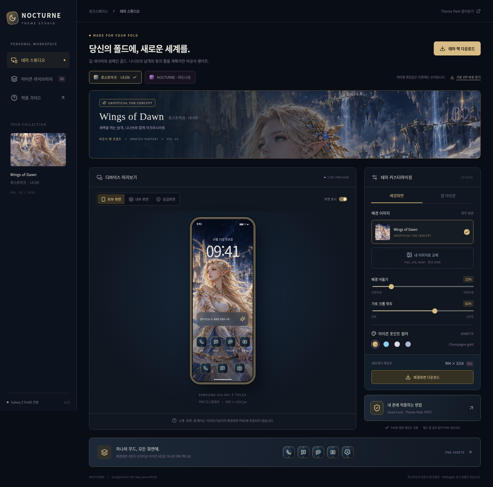
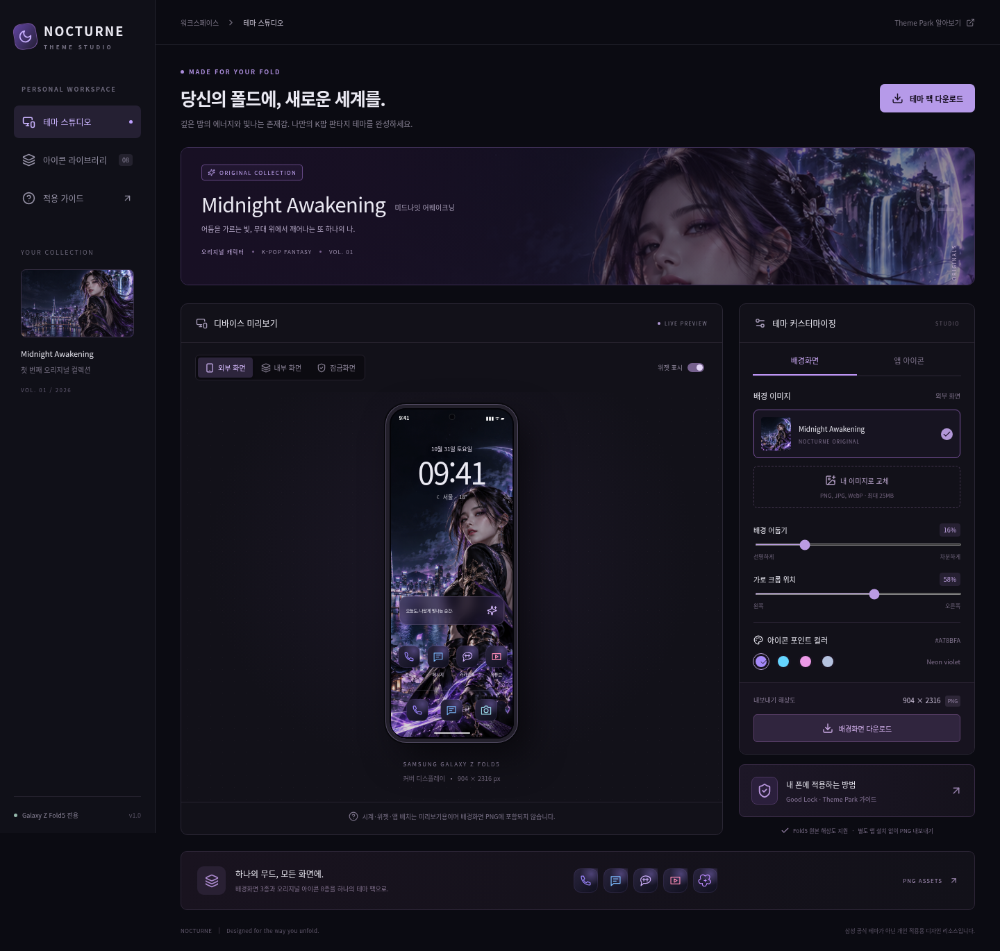

# NOCTURNE · Galaxy Z Fold5 Theme Studio

## 전체 테마로 확장하기 · Theme Park 개인 적용

**[니나브 전체 테마 설계·수동 적용 가이드](design/full-theme/README.md)** · **[휴대폰 수동 적용팩 ZIP](public/downloads/LOSTARK-Nineveh-ThemePark-Manual.zip?raw=true)** · **[제작자료 ZIP](public/downloads/LOSTARK-Nineveh-Fold5-Design-Kit.zip?raw=true)**

사용자 확인된 폴드5 / One UI 8.5의 테마·키보드·퀵패널·아이콘·음량패널을 대상으로 색상 입력표와 7종 디자인 시안을 추가했습니다. 웹 하단의 ‘전체 테마 설계 보기’에서 확인할 수 있습니다. 제작자료는 PNG/SVG 시안·부품·기존 배경/아이콘·색상표이며, 설치형 삼성 테마나 Theme Park 가져오기 파일이 아닙니다. 실제 기기에서 지원 항목에 색상을 입력하고 저장·적용하는 단계는 아직 수행하지 않았습니다.


## 새 컬렉션: 로스트아크 · 니나브 — Wings of Dawn

딥 네이비·샴페인 골드·천공의 성전을 배경으로 니나브를 재해석한 비공식 AI 팬아트 테마를 추가했습니다. 기본 화면은 니나브 테마이며 상단 컬렉션 선택으로 기존 미드나잇 컬렉션에 돌아갈 수 있습니다. 테마별 이미지·어둡기·크롭·컬러 편집값은 서로 독립적으로 유지됩니다.

- **[니나브 테마 ZIP 바로 받기](public/downloads/LOSTARK-Nineveh-Fold5.zip?raw=true)** — 배경 3종, 아이콘 8종, 적용 가이드.
- [새 디자인 설명과 적용법](design/lostark/README.md)
- [기존 NOCTURNE ZIP](public/downloads/NOCTURNE-Fold5.zip?raw=true)



사용자가 선택한 특정 캐릭터 방향에 따라 니나브 팬아트로 제작했습니다. 제공된 삼성 참고 링크는 환경의 접근 정책에서 차단되어 내용을 확인하지 못했습니다. 참고 페이지와 동일한 디자인이나 공식 캐릭터 원화를 사용했다고 주장하지 않습니다. 로스트아크·니나브 관련 권리는 원 권리자에게 있으며, Smilegate 공식 상품이나 삼성 설치형 테마가 아닙니다.

아래 기존 NOCTURNE 컬렉션과 동일한 실행·수동 적용 방법을 사용합니다.


블랙·퍼플·네온 블루의 K팝 판타지 테마 제작 도구. 오리지널 여성 캐릭터 ‘미드나잇 어웨이크닝’ 일러스트와 앱 아이콘을 포함합니다. React + TypeScript + Vite로 제작했으며, 모든 UI와 적용 가이드는 한국어입니다.



## 시작하기

Node.js 22 이상과 npm을 권장합니다. 검증 환경: Node.js 24.19.0, npm 11.9.0, Linux Chromium.

```bash
npm ci
npm run dev
```

터미널에 출력된 개발 서버 주소를 브라우저에서 엽니다. 개발 서버는 클라우드 사용을 위해 `0.0.0.0`에 바인딩됩니다.

```bash
npm run build       # TypeScript 검사 + dist/ 프로덕션 빌드
npm run preview     # 빌드 결과 확인
```

백엔드·API 키·회원가입은 필요하지 않습니다. 이미지 교체와 PNG/ZIP 생성은 브라우저 안에서 처리하며 서버에 업로드하지 않습니다. 이미지와 편집값은 세션 메모리에 있으므로 새로고침 전에 다운로드하세요.

## 구현된 기능

| 기능 | 실제 동작 |
| --- | --- |
| 외부 화면 | 904 × 2316 PNG, 해당 비율의 디바이스 미리보기 |
| 내부 화면 | 1812 × 2176 PNG, 펼친 기기 미리보기 |
| 전용 잠금화면 | 904 × 2316 PNG, 시계 영역을 위한 상단 암부 오버레이 |
| 이미지 교체 | 화면별 PNG/JPEG/WebP 선택, 최대 25MB·4천만 픽셀 |
| 배경 조정 | 가로 크롭 위치·어둡기, 다운로드에 반영 |
| 앱 아이콘 | 전화·메시지·카카오톡·유튜브·갤러리·카메라·설정·음악 8종, 개별 192 × 192 PNG |
| 포인트 컬러 | 아이콘 배경 광원과 테두리 4색 전환 |
| 전체 내보내기 | 배경 3종·아이콘 8종·적용 안내를 ZIP으로 다운로드 |
| 적용 안내 | 앱 내 가이드와 아래 수동 적용 절차 |

미리보기 시계·날씨·상태바·문구·위젯·앱 배치는 고정된 예시입니다. 실제 기기 정보나 동작하는 런처가 아니며, PNG에 포함되지 않습니다. 내보내기는 원본 이미지를 화면 비율에 맞춰 중앙 세로 크롭하고 가로 위치를 적용합니다. 전체 테마 팩은 현재 어둡기·위치·색상을 세 화면에 공통 적용하며, 교체 이미지는 화면별로 유지합니다.

## 코드와 디자인 리소스

```text
src/
  main.tsx               한국어 스튜디오와 적용 가이드
  theme.ts               화면 규격과 오리지널 SVG 아이콘 정의
  export.ts              Canvas PNG / JSZip 내보내기
  styles.css             반응형 다크 UI
public/art/nocturne.png   AI 생성 오리지널 캐릭터 원본 (1086 × 1448)
design/
  README.md              디자인 컨셉·출처·해상도 설명
  preview.png            웹 스튜디오 스크린샷
  exports/wallpapers/     바로 적용할 수 있는 기본 배경 PNG 3종
  exports/icons/          기본 아이콘 PNG 8종
scripts/export-assets.mjs  웹 앱에서 기본 리소스 재생성
tests/studio.spec.ts      실제 브라우저 통합 테스트
```

기본 PNG를 바로 사용하려면 `design/exports/`를 기기로 복사하세요. 새 디자인을 만들 때는 웹 스튜디오에서 이미지를 교체해 다시 다운로드합니다. 내보내기 해상도는 기기 픽셀 규격이며, 기본 일러스트는 원본보다 큰 내부 화면 출력에서 확대됩니다. 네이티브 고해상도 원화를 원하면 더 큰 소스로 교체하세요. 세 배경은 같은 원화를 화면별 크롭·잠금화면 암부 처리로 변형한 디자인입니다.

## 삼성 Good Lock / Theme Park 적용

1. **파일 전송**: 웹에서 ‘테마 팩 다운로드’를 누릅니다. ZIP을 폴드5에 옮기고 ‘내 파일’에서 압축을 풉니다.
2. **외부 배경**: 기기를 접은 상태에서 **설정 → 배경화면 및 스타일 → 배경화면 변경 → 갤러리**에서 `cover-904x2316.png`를 홈 화면으로 지정합니다.
3. **내부 배경**: 기기를 펼치고 같은 경로에서 `inner-1812x2176.png`를 지정합니다. 기기 설정에 따라 화면별 적용·커버 화면 미러링 옵션을 확인하세요. 두 화면이 같은 배경을 공유하면 One UI의 화면별 설정과 미러링을 먼저 확인합니다.
4. **잠금화면**: `lock-904x2316.png`를 외부 잠금화면으로 지정합니다. 내부 잠금화면에는 `inner-1812x2176.png`를 사용합니다. 시계 크기·색·알림 위치는 기기의 잠금화면 편집 기능으로 별도 조절합니다.
5. **아이콘**: Galaxy Store에서 **Good Lock**, 그 안에서 **Theme Park(테마파크)**를 설치합니다. Theme Park의 **아이콘 → 새로 만들기**에서 개별 앱의 아이콘 이미지 변경 메뉴를 사용해 `icons/`의 PNG를 지정합니다. 아이콘 테마를 이름과 함께 저장하고 적용합니다. 기존에 Theme Park에서 만든 아이콘 팩이 있다면 복제하거나 새 팩을 만들어 보존하세요.
6. **확인**: 접힘·펼침 상태에서 아이콘 잘림, 텍스트 대비, 알림 배지를 확인합니다. 원복은 기기의 기본 배경 및 기본 아이콘 테마를 다시 선택하면 됩니다.

메뉴명·개별 앱 편집 기능·Good Lock 제공 여부는 One UI/Theme Park 버전과 지역에 따라 달라집니다. 개별 이미지 선택이 없는 버전에서는 앱 업데이트와 해당 버전의 삼성 안내를 확인하세요. 웹 앱은 기기의 설정을 자동 변경하지 않습니다.

### 지원 범위와 제한

- 삼성 공식 테마, 설치형 APK 또는 `.mtpk` 파일을 생성하지 않습니다. **수동 적용용 PNG 리소스**를 제공합니다.
- 전화·메시지·카카오톡·유튜브 등의 **런처 아이콘 이미지**만 제공합니다. 통화 화면, 메시지 UI, 카카오톡 대화방, 시스템 알림창·상태바는 테마에 포함되지 않습니다.
- 아이콘은 공식 앱 로고가 아닌 오리지널 대체 심볼이며, 특정 앱과의 제휴를 의미하지 않습니다.
- 실물 폴드5에서 적용 여부를 검증하지 않았습니다. 파일 규격과 웹 내보내기 동작을 검증했습니다.
- 브라우저 파일 다운로드를 허용해야 합니다. 업로드 오류는 UI 알림으로 표시됩니다. 외부 이미지 URL 입력은 제공하지 않아 Canvas CORS 문제를 피합니다.

## 검증 및 리소스 재생성

```bash
# 시스템 Chromium이 없으면 Playwright 브라우저를 설치합니다.
npx playwright install chromium
npm test
```

Linux `/usr/bin/chromium`이 있으면 이를 사용합니다. 다른 설치 경로는 `CHROMIUM_PATH=/경로/브라우저 npm test`로 지정할 수 있습니다. 테스트는 로컬 Vite 서버를 자동 시작합니다. 실제 PNG 시그니처·픽셀 규격, ZIP 파일 12개, 화면 전환, 이미지 교체 격리, 크롭·어둡기, 위젯 토글, 적용 안내, 모바일 가로 넘침과 브라우저 런타임 오류를 검증합니다.

기본 디자인 PNG를 다시 생성하려면 한 터미널에서 `npm run dev -- --port 5173`, 다른 터미널에서 `node scripts/export-assets.mjs lostark` 또는 `node scripts/export-assets.mjs nocturne`를 실행하세요. 이 스크립트는 선택한 테마의 기본값으로 웹 내보내기를 수행해 각각 `design/lostark/exports/` 또는 `design/exports/`를 덮어씁니다. 미리보기 PNG와 `public/downloads/`의 해당 ZIP도 함께 생성합니다. 디자인 파일을 수정했다면 먼저 보관하세요.

## 디자인 출처

캐릭터 일러스트는 기존 NOCTURNE 원화는 이 프로젝트용 AI 생성 오리지널 디자인입니다. 해당 원화에 특정 영화·애니메이션의 캐릭터, 로고, 스틸을 사용하지 않았습니다. 새 니나브 컬렉션은 별도의 비공식 캐릭터 팬아트이며, 디자인 설명은 `design/lostark/README.md`를 참조하세요. K팝 판타지 장르의 무대 의상과 도시의 야경을 참고한 별도 콘셉트입니다. UI 아이콘은 lucide-react(ISC), 앱 대체 아이콘은 프로젝트의 SVG 정의를 사용합니다. 웹 폰트나 외부 이미지 CDN에 의존하지 않습니다.
