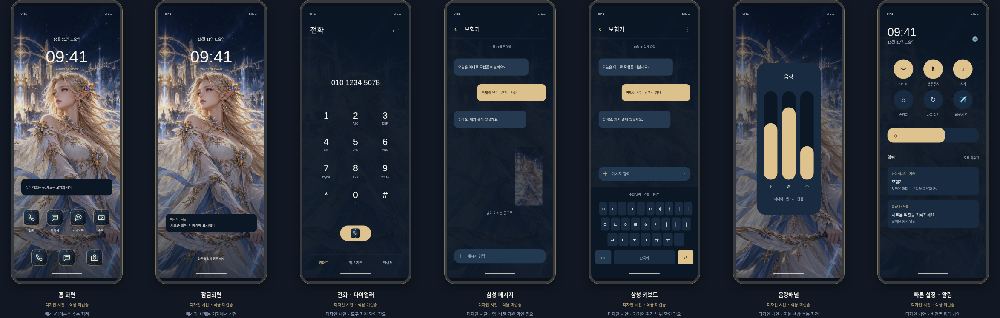

# 니나브 · 전체 테마 설계 및 Theme Park 적용자료

대상은 **사용자가 확인한 Galaxy Z Fold5 / One UI 8.5 / Theme Park**입니다. 사용자가 확인한 탭은 **테마·키보드·퀵패널·아이콘·음량패널**입니다. 이 프로젝트가 실제 기기를 원격 확인하거나 테마를 적용한 것은 아닙니다.

**[휴대폰 수동 적용팩 ZIP](../../public/downloads/LOSTARK-Nineveh-ThemePark-Manual.zip?raw=true)** · [제작자료 ZIP](../../public/downloads/LOSTARK-Nineveh-Fold5-Design-Kit.zip?raw=true) · [전체 화면 시안](screen-lineup.png) · [색상 입력표](exports/ThemePark-색상입력표.html)



## 무엇을 만들었나

- 홈·잠금·전화·삼성 메시지·삼성 키보드·퀵패널·음량패널의 7종 디자인 시안. SVG 원본과 904 × 2316 PNG.
- 말풍선·키·활성/비활성 토글·알림 카드·음량 슬라이더의 SVG/PNG 9종.
- 기존 실제 수동 지정용 배경 PNG 3종, 런처 아이콘 PNG 8종.
- 색상 명세와 권장 매핑, 휴대폰에서 읽을 수 있는 독립 HTML 입력표, 적용 순서.
- 웹 스튜디오 하단의 **전체 테마 설계 보기**와 **제작자료 ZIP 다운로드**.

## 가장 먼저 적용할 값

| 색상 역할 | HEX |
| --- | --- |
| 전체 바탕 | `#0C1726` |
| 카드·일반 키·패널 | `#192B40` |
| 입력창·보조 패널 | `#223A51` |
| 활성 버튼·토글·슬라이더 | `#DFC38E` |
| 골드 위 글자·아이콘 | `#241A0A` |
| 기본 글자 | `#F5F3ED` |
| 보조 글자·꺼진 아이콘 | `#BBC7D7` |
| 수신 말풍선 | `#253A50` |
| 발신 말풍선 | `#DCC18D` |

원하는 색상을 다시 고를 필요 없이 이 값을 대응 항목에 입력하세요. 항목명은 의미를 기준으로 한 권장 역할이며 실제 편집기의 슬롯명을 기록한 것이 아닙니다. 제공되지 않는 세부 항목은 변경할 수 없습니다.

## 내 기기 적용 순서

1. 휴대폰용 수동 적용팩 ZIP(배경·아이콘·색상표 15개 파일)을 풀고 `ThemePark-색상입력표.html`을 휴대폰에서 엽니다. 파일을 열지 못하면 이 README의 표를 참고하세요.
2. **테마**: 새 테마를 만들고 기존 배경 PNG를 선택합니다. 강조는 골드, 바탕은 네이비, 글자는 아이보리로 시작합니다. 앱별 상세 색상 편집이 제공되는 항목에 한해 전화·삼성 메시지 색상을 조정합니다. 저장 후 적용하세요.
3. **키보드**: 삼성 키보드 기준으로 바탕 `#0C1726`, 일반 키 `#192B40`, 글자 `#F5F3ED`, 액션 키 `#DFC38E`, 액션 키 글자 `#241A0A`. 별도 테마로 저장·적용합니다.
4. **퀵패널**: 바탕 `#0C1726`, 켜진 버튼 `#DFC38E`, 켜진 아이콘 `#241A0A`, 꺼진 버튼·알림 카드 `#192B40`, 꺼진 아이콘 `#BBC7D7`, 알림 글자 `#F5F3ED`. 별도로 저장·적용합니다.
5. **아이콘**: `device-resources/icons/`의 PNG를 개별 앱에 지정합니다.
6. **음량패널**: 패널 `#192B40`, 트랙 `#0C1726`, 채움 `#DFC38E`, 아이콘 `#F5F3ED`. 지원되는 항목만 지정하고 저장·적용합니다.
7. 기본 배경·키보드·아이콘으로 복구할 위치를 확인한 뒤 실제 전화·삼성 메시지·키보드·알림·음량 화면에서 접힘/펼침, 라이트/다크 모드를 검사합니다. 실기 검증 전에는 완성 테마가 아닙니다.

## 파일의 구분

- `source-art.png`: SVG들이 공통 참조하는 원화. SVG 파일과 상대 폴더 위치를 유지하세요.
- `design-previews/`: 글자·숫자·버튼까지 그려진 **디자인 시안**. 배경화면으로 적용하지 마세요.
- `assembly-assets/`: 개별 부품 설계 원본. 공식 삼성 템플릿이나 9-patch 파일이 아닙니다. 도구에서 이미지 교체가 지원되는 항목에 맞춰 조립·재작업해야 합니다.
- `device-resources/`: 기존 PNG 팩과 같은 배경/런처 아이콘. 앱 내부 UI를 자동 변경하지 않습니다.
- `palette.json`: 색상 명세·권장 매핑. `installable: false`, `themeParkImport: false`, `deviceValidated: false`로 상태를 기록합니다.
- `ThemePark-색상입력표.html`: 독립 참조 문서. 네트워크나 JavaScript가 필요하지 않습니다.

## 아직 안 된 일과 지원 한계

Theme Park 편집기에서 색상을 수동 입력하고 저장·적용하는 작업은 사용자의 기기에서 해야 합니다. 이 클라우드에는 기기 조작 수단이 없습니다. 설정 파일을 자동으로 주입하거나 임의의 Theme Park 프로젝트 형식을 만들어내지 않습니다.

전화·메시지 등에 **색상을 적용하는 기능**과 **캐릭터 배경/키패드/말풍선 이미지를 임의 배치하는 기능**은 다릅니다. 현재는 전자의 지원 항목에 맞춘 입력표를 제공합니다. 후자가 One UI 8.5의 해당 편집기에서 가능하다는 확인은 없으며, 시안과 똑같이 적용된다고 보장하지 않습니다. 지원되지 않는 이미지 삽입·레이아웃 변경은 구현한 것으로 표시하지 않습니다.

삼성 메시지의 시안은 Google 메시지·카카오톡에 적용되지 않습니다. 삼성 키보드 시안은 Gboard에 적용되지 않습니다. 외부 화면 규격으로 제작한 앱 시안이며 펼친 화면에서의 실제 앱 레이아웃은 별도 확인이 필요합니다.

설치형 APK/삼성 테마 패키지, 공식 Theme Studio 프로젝트, Theme Park 가져오기 파일은 생성하지 않았습니다. 전체 테마의 공식 제작 도구가 필요한 경우 현재 제공 조건과 디자이너 권한은 [삼성 공식 사이트](https://developer.samsung.com/galaxy-themes/overview.html)에서 확인해야 합니다. 본 환경에서는 해당 사이트가 프록시 정책으로 차단되어 최신 조건을 확인하지 못했습니다.

## 재생성·검증

```bash
npm run dev -- --port 5173
# 다른 터미널에서:
node scripts/export-full-theme.mjs
node scripts/package-themepark.mjs
npm run build
npm test
```

내보내기 스크립트는 니나브 기본값 기준으로 `design/full-theme/exports/`, 미리보기 두 장과 `public/downloads/LOSTARK-Nineveh-Fold5-Design-Kit.zip`을 덮어씁니다. 수정한 디자인은 먼저 보관하세요. 테스트는 7종 PNG의 시그니처·크기, 47개 파일 구성, SVG 원본·색상표·설치 불가 상태 메타데이터, 모바일 가로 넘침을 검증합니다. 기기 적용은 테스트 대상에 포함되지 않습니다.
